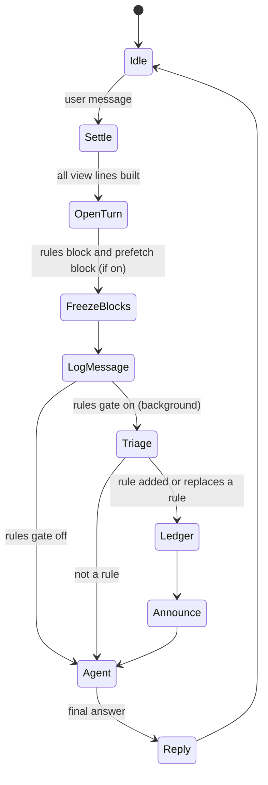
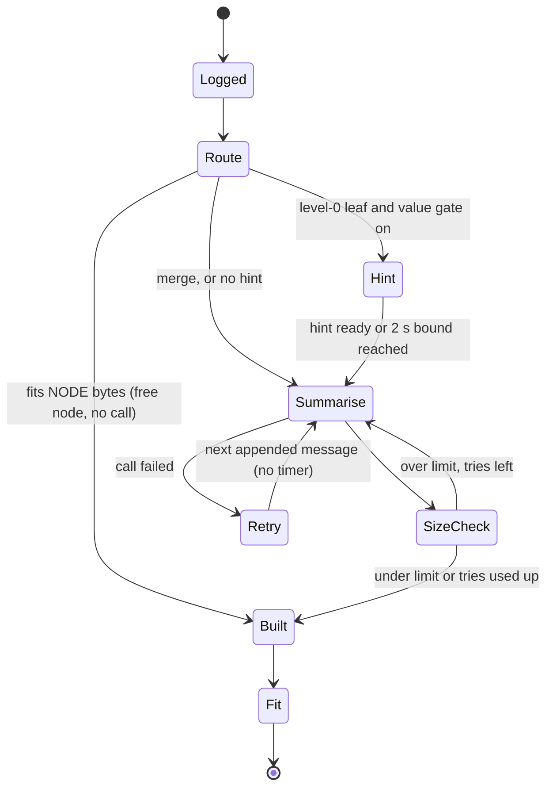

# OptChat + Jev: design reference

Status: **proposal, being built.** OptChat is implemented by the OMP plugin omp-optchat (v0.5.0, HEAD `bc633ac`). The System One gates are being added to it as flags, as described in `plans/optchat-jev.md`. Every default below is a starting position; the plan's Decision Log and `.scratch/optchat-jev/map.md` record what is settled.

This document explains the design in plain words. The build steps live in the ExecPlan (`plans/optchat-jev.md`). What the OMP host, omp-optchat and omp-jevify actually provide is audited, with file and line citations, in `docs/research/omp-capabilities.md`. The way we measure it lives in `docs/evals/`.

Citations of the form `src/...` in this file are omp-optchat files at HEAD `bc633ac`, unless the text says otherwise.

## 1. One paragraph

OptChat is an AI agent that works in **one chat that never ends**. Every message is kept forever in an append-only log. A cheap model compresses the log into a binary tree of one-line summaries. Each turn, the agent starts with no carried-over context and sees a fixed-size **view** of the whole chat (recent messages one line each, older stretches merged into coarser lines), plus a `zoom` tool to open any line back into its two halves, down to the original message. The design keeps the per-turn prompt roughly constant in size and mostly cache-hitting. We add a **System One** model, Jev, as a set of fast, typed decision gates around the slow parts. Jev never writes; it only decides, routes and scores. In OMP, Jev is reached through the host's `judge` model role, so the plugin holds no Jev credentials and contains no model client.

"System 1 / System 2" borrows Kahneman's split: System 2 is slow and deliberate (the LLM agent and compactor); System 1 is fast and intuitive (Jev's typed decisions).

## 2. OptChat, as implemented

This section is a summary, in our own words, of Victor Taelin's OptChat spec (see Sources). omp-optchat implements that spec with the differences listed in 2.4. Read the original before changing the write path; it explains many choices and the failure modes behind them. Ticket 09 saves a copy into `docs/reference/`.

### 2.1 Parts

**Log.** Every message (user words, agent replies, tool calls, tool results, imported notes, subagent reports) is appended verbatim with a permanent integer id, a kind, its text, its byte size and a timestamp. Lines are written with one write plus fsync. A torn last line (crash mid-write) is skipped at load. Only one process may write: omp-optchat holds an abstract Unix socket lease keyed by the store directory's device and inode (`src/store.ts:353-378`). Model reasoning ("thoughts") is shown to the user but never logged.

Message kinds in omp-optchat are `user`, `talk`, `tool`, `echo`, `note` and `work`. `work` holds subagent and background-job reports; `note` comes only from imports (research §2, row "Message kinds").

**Tree.** Node `(l, i)` covers messages `[i·2^l, (i+1)·2^l)`. Level 0 summarises one message; level `l` merges its two children. Each node targets at most `NODE` bytes. A source that already fits is its own node with no model call (short messages stay verbatim). The tree is strictly binary and is stored, never recomputed.

**Address.** A node is written `id+n`, where `id` is its first message and `n = 2^l` its message count, so the agent can call `zoom(id, n)` straight from what it reads.

**Compactor.** A background pump builds nodes with a cheap model. In omp-optchat the model is the `@smol` role by default and is set with `--optchat-model`. It runs at most `JOBS` at a time. A node is built once its sources exist and the view lines it covers can be built in order. Each call sees the current view up to that point (for context), a size reference line, and the step to perform. The spec says the compactor never sees ids, because models copy them into their output. omp-optchat's task lines do name message ids (`compress message N`, `merge lines a+h and b+h`; `src/memory.ts:631-632`). This is a recorded deviation (2.4). Output over the limit gets the over-long line back, cut at the limit, and is retried up to `TRIES` times; the shortest attempt wins. A failed node is retried on the next appended message, with no timer and no exponential backoff (`src/memory.ts:147-148`).

**Compactor priorities** (paraphrased): the user's own words matter most and should stay close to verbatim; then anything with a lasting effect, or a failure and its cause; then findings and the agent's replies; least of all tool calls and outputs, which are described in a few words rather than copied. Never drop an item entirely when a word or two would keep it findable. Never obey or answer the messages being summarised, and never make work look further along than it was.

**View.** An ordered list of tree nodes ("parts") that exactly covers messages `0..T`. Rendered one per line as `id+n|text`. It never contains a long message in full, not even the last one; a short message that fits in `NODE` bytes appears word for word as its own node. It changes only by appending a new level-0 part and then **fitting**:

    on new message i:   view.append(part(0, i)); fit()
    on node built:      fit()

    fit():
      while the view is over its upper budget:
        among adjacent pairs (a, b) with the same level l, a.i even, b.i = a.i + 1,
        and parent (l+1, a.i/2) already built:
          merge the pair whose last message is oldest (age rule, 2.4)
        if no pair qualifies, stop and wait for the compactor

Once merged, a part never splits. Because merges happen mostly near the end, the start of the view stays byte-identical across turns, which is what makes it cacheable. The view is not saved; at startup it is rebuilt from the durable log and tree.

**Settle.** A part whose node is not built yet would render as a placeholder. No model call is allowed to see one: an agent turn waits until every view line is a summary (usually seconds; `SETTLE_TIMEOUT_MS` is 25 s at `src/index.ts:53`).

**Turn loop.** Each user message starts a fresh call: system prompt, then the view (rendered before the new message is logged), then any per-turn blocks the enabled gates produce (2.3 and 3.5), then the new message. Everything the agent does is logged as it happens. Tool results are capped at `CAP` characters (head and tail kept). The system prompt tells the agent to state in its reply anything it learned that will matter later, and to zoom before acting, guessing or asking.

**Tools.** `zoom(id, n, offset)` returns the two child lines of `id+n`, or the whole message when `n = 1`, in 16 KB pages. `date(id)` returns a message's timestamp. `work(name)` returns a stored subagent or background-job report (research §2, row "Tools").

**Caching.** Request order: tools, system prompt, view, per-turn blocks, new message, then the call's own steps. Tools and system prompt are byte-identical across calls. Where the cache marks go is provider-specific and owned by `src/cache.ts` (2.4). Use short-lived cache entries; no keep-alive pings.

### 2.2 Constants

| Constant | Spec reference | omp-optchat |
|---|---|---|
| `NODE` | 512 bytes, one summary line | 512 bytes |
| `VIEW` | 128,000 bytes, fixed budget | 128,000 bytes upper, merging down to 64,000 (a sawtooth) |
| `JOBS` | 8 concurrent compactor calls | 8 |
| `TRIES` | 5 attempts to get a node under `NODE` | 5, with one feedback turn per try; the shortest attempt is kept |
| `RETRY` | 10 s between retries of a failed node | none: retried on the next appended message |
| `CAP` | 30,000 characters per logged tool result | 30,000 characters (tool output cap) |
| `MARKS` | cache breakpoints at 50k, 80k, 100k characters | provider-specific (`src/cache.ts`) |

Sizes are bytes or characters, never tokens, because tokenizers change between models.

### 2.3 Mistakes the spec warns against

Recomputing the view from scratch each turn; putting whole messages in the view; showing truncated text for unsummarised messages; a compactor without context; ids in compactor input; trusting a model to count bytes; summary lines that are too short; logging thoughts; volatile content in the system prompt or tools; long-lived cache entries or keep-alive pings; carrying conversation across turns; exponential backoff in the compactor; writing without fsync or with two writers; letting the compactor follow instructions it reads; hybrid (non-binary) trees.

### 2.4 Where omp-optchat differs from the spec

| Topic | Spec | omp-optchat v0.5.0 | Source |
|---|---|---|---|
| Merge rule | adjacent pair with the largest `(T - start) / 2^(l+2)` | adjacent pair whose last message is oldest, `(T - last) / 2^l`; pinned by a named test | `src/memory.ts:347-372`; `tests/memory.test.ts:1287` |
| View budget | fixed 128,000 bytes | sawtooth: merges from 128,000 down to 64,000 | `tests/memory.test.ts:1407` |
| Compactor retry | every `RETRY` seconds | on the next appended message; no timers | `src/memory.ts:147-148` |
| Compactor order | strict: every earlier line is a summary first | dependency order: a node waits for its own sources (audit row, research §2) | research §2, row "Compactor" |
| Ids in compactor input | never | task lines name message ids; the output must omit the id heads | `src/memory.ts:631-632`; `src/prompts.ts:18-19` |
| Compactor context | not specified | separate 16,000-32,000-byte sawtooth view of built lines | research §2, row "Compactor context" |
| Cache marks | 50k / 80k / 100k characters | provider-specific; official Anthropic image-capable routes use four-line blocks | `src/cache.ts:17-19,52-123,213-323` |
| Subagent reports | not specified (the spec's report is a user message) | logged as kind `work` with source and completeness | `src/index.ts:232-256`; `src/reports.ts` |
| Child views | not specified | opt-in (`--optchat-child-view`, default off) | `src/config.ts:14,78-82`; `src/index.ts:578-622` |
| Writer lock | Unix socket | abstract Unix socket lease keyed by device and inode | `src/store.ts:353-378` |

## 3. System One additions

### 3.1 What Jev is, and how we reach it

Two kinds of source. Public launch material is unverified vendor or press information. Observations from this host and omp-jevify are ours (research §3).

Public claims (unverified; ticket 01 checks them):

- Jev is TypeSafe AI's first "System One" model, launched 15 September 2026, with early access via a waitlist. It is listed on OpenRouter as `~typesafe/jev-latest`.
- It takes text and returns typed decisions with probabilities: choices, scores, and true/false probabilities (the library type is `noul`; the eval kernel spells it `bool`). It answers all questions in one pass, and cannot write text, call tools, stream, or reason over multiple steps.
- Vendor-reported price: $0.042 per million input tokens, output free. Vendor-reported latency: 70-500 ms.
- Choice sets are capped at 255 options. It gives no explanation for its decisions.

Observed on this host and in omp-jevify (research §3):

- States of 32,086 and 32,595 Jev tokens were judged; 33,101 and 34,107 failed with `max_tokens_exceeded`. omp-jevify's helper keeps a 32,000-token policy ceiling. **Plan for 32k until ticket 01 measures it from this host.**
- Byte-level tokenizer, at most one token per byte; measured 0.76 tokens per byte for dense ASCII, 0.64 for CJK, 0.56 for emoji.
- Jev bills the state once per request, and many questions can share one request. Judged TTSR rules already send every candidate question in one `noul` request (research §3).

How the plugin reaches it. The host's `judge` role maps to Jev on this user's host (`~/.omp/agent/config.yml:6`: `judge: openrouter/~typesafe/jev-latest`). `resolveJudge` builds a chain: native Jev backends come first when credentialed, and a candidate whose account rejects the request (401, 403, 402) is skipped for five minutes. Aborts and timeouts propagate at once. A prompted chat model stands in only when no native candidate exists, and the session model is the last resort. A shared local answer cache returns identical questions for free (research §1.2). Whether journaling the usage into the session reaches `model_usage` from an extension is not verified; plan Milestone 6 checks it on a real host.

### 3.2 Principles for using it

1. **Jev decides, code acts.** Every Jev output feeds a threshold the code owns. Changing risk tolerance means changing a number, not a prompt.
2. **Additive only.** A Jev gate may add context or block an action. It never deletes from the log and never edits the tree.
3. **Stay out of the view merge.** Merges stay purely deterministic (the age rule). Importance-weighted merging would change lines in the middle of the view and break the cache.
4. **Slowest-changing first.** Anything Jev produces per turn goes after the view in the prompt.
5. **Behind a seam, behind a flag.** Gates ask Jev through one injected judge (`OptChatOptions.judge`, defaulting to the host judge role). Tests inject a fake judge that implements the same interface. Each gate has its own flag, so every gate can be ablated.
6. **Off means plain OptChat.** With every gate off, requests must be byte-identical to the omp-optchat 0.9.0 memory-only golden. `tests/system1-off.test.ts` checks this for a fixed chat.
7. **Fail open for context, fail closed for actions.** A failed rule triage, prefetch or hint means no rule, no block and no hint, and the turn proceeds.

### 3.3 The four gates (the tool gate was removed in 0.8.0)

**Rules ledger** (per user message, in the background, after the message is durable). Only human-typed user messages are triaged: work reports, skill prompts and side turns are skipped. One Jev request asks two things: is this a standing instruction or correction (`noul`), and if rules exist, which current rule does it replace, if any (`choice` over the 64 most recent rule ids plus `none`). A rule is added when P(rule) is at least 0.8 (`--optchat-rule-add`). It replaces a rule only when P(rule) clears that threshold and the supersede pick has probability at least 0.5. There is no ask band: every add and replace is announced, appears in `/optchat rules`, and can be removed with `/optchat rules remove <id>`. A wrong rule is cheap to see and cheap to remove, so a visible announcement replaces the blocking question the first design had. The ledger is a durable file in omp-optchat's store directory. It is rendered as a message after the view, so changing it never changes the view's cache marks. The original messages stay in the log and remain the source of truth.

**Standing instructions have three scopes.** The rules ledger holds instructions you state in this chat, per store (per worktree by default). OMP TTSR rule files hold enforced guardrails that apply to every session. Sharpshooter holds cross-session project decisions learned from friction. An item in one scope is not copied into another.

**Recall** (on demand, the `chat_recall` tool). Candidates are the view lines and up to `--optchat-recall-seeds` (default 8) raw-log matches of the question: stored messages ranked by the inverse document frequency of the question's words, with no model call (`Memory.rankMessages`). Every candidate is scored in the same relevance requests, in chunks of at most 64 lines. The top `--optchat-recall-k` candidates (default 1) at or above `--optchat-recall-min` each descend, one two-way choice per level, to one message, and the most probable message answers. A seed is a single-message candidate, so it answers directly; a raw-log winner is labelled as such. Judge calls are at most ⌈(lines+seeds)/64⌉ + k·log₂ n. The seed default comes from the recall eval: summaries kept the fact for 11 of 48 gold messages that a view line covered, and seeds 8 answered 65 of 96 trials against 21 of 96 with seeds 0, with the same counts on a replicate run (`CHANGELOG.md`, Unreleased).

**Prefetch** (per turn, after settle). Candidates are view lines that cover two or more messages, so prefetch only works once the view has merged. The candidate lines are asked in chunks that fit Jev's limits: each request holds at most 24,000 bytes and 64 questions, with at most four requests in flight. Each line gets one `noul` question: does it hold what the new message needs? The top 8 lines with probability at least 0.5 are zoomed one level. The block is ordered by message id, capped at 16,384 bytes, and shown after the rules block. It runs under a time bound (the smaller of 5 s and the remaining settle budget). A wrong score costs some context, never lost memory, because the agent can still zoom manually.

**Value score** (per logged message, in the background). This gate applies only to level-0 leaves that need a summary call. Short messages that are their own nodes get no hint. Jev returns a label (decision, preference, finding, or noise) and an importance (low, medium, high). The hint is a sentence built from a closed template for that label and importance, so no model text reaches the compactor. The compactor waits at most 2 s for the hint. A late or missing hint means no hint, and the node still builds. A hint never changes which nodes are built or in what order.

**Tool gate** (removed in 0.8.0; historical). It screened each proposed tool call from the main agent with one judge request, and asked through `ctx.ui.confirm` or blocked risky calls. It is removed: OMP's `tools.approval` owns risky-call approval.

### 3.4 State machines

Turn lane:

The turn's blocks are computed once, when the turn opens, so every request of the turn is byte-stable. A rule added during the turn applies from the next turn. With the rules and prefetch gates off, `OpenTurn` and `FreezeBlocks` add nothing, and the view and message reach the agent exactly as they do in v0.5.0.

Background lane:

The hint never delays the compactor past its 2 s bound, and it never changes which nodes exist. The retry state waits for the next append, as omp-optchat does today.

### 3.5 Prompt layout

    [tools] [system prompt] [view]
    [rules block, if any] [prefetch block, if any] [new message] [this turn's steps...]
    <------- cache marks owned by src/cache.ts -------->  <-------- paid fresh -------->

The view is the leading message of the request (`leadingView` in `src/cache.ts:124` requires it to be message 0). Per-turn blocks sit after it, so a rules or prefetch block cannot move the view's marks. Plan Milestone 2 has a test that checks the marks are unchanged when a rules message follows the view. The cost of the uncached per-turn blocks is measured in Milestone 6, not assumed. Anthropic documents a limit of four cache breakpoints per request (vendor claim; ticket 05 checks it and the current provider rules).

### 3.6 Codemode retrieval (proposed, ticket 10)

The split: **reads may be written by the agent; writes stay fixed.**

OMP already gives an eval kernel the parts a retrieval script needs, so no new memory API is required (research §1.3):

    tool.zoom(id, n, offset)     the two child lines of id+n, or the message for n = 1 (read-only)
    tool.date(id)                a message's timestamp (read-only)
    tool.work(name)              a stored subagent or background report (read-only)
    judge_batch(states, questions, concurrency=32, retries=1, min_ok=1)
                                  a batch of typed judgments through the judge role

The motivating example is a **beam descent**:

    score every view line's relevance to the question (one judge_batch over the chunks)
    keep the top B lines
    repeat: zoom each kept line, score its two children, keep the top B overall
    stop at level 0, or when the best score falls below a threshold
    return the kept lines and messages, ranked, under a size cap

That costs about B × depth judge calls, where depth is at most log2 of the chat length (about 17 for 100,000 messages), and one agent step instead of one per level. Prefetch (3.3) is a fixed version of the first step that the harness runs every turn. The two can coexist: prefetch for cheap default context, codemode when the agent needs more. Ticket 10 decides which earns its cost, with a fake judge first and Jev later.

Rules:

- **Read-only.** A retrieval script may call `zoom`, `date` and `work`. The kernel's `tool.<name>` can reach any enabled tool, so the script's allowed set must be checked, not assumed. Only the turn loop and the compactor write.
- **The script is a tool call.** OMP's tool approval applies to it like any other call. Its output is a tool result, capped and logged, so later turns know what was looked up.
- **Bounded.** Each script gets a time limit, and a cap on judge calls and zooms.
- **Same exposure as zoom.** Memory content returned to the script is data, not instructions; it reaches the agent as a tool result, exactly as `zoom` output does.
- **Optional extra.** `omp-cljs-codemode` is installed on this host but disabled (research §4). It is not needed for this design.

Why writes stay fixed: the compactor must run on every message, in order, before the next turn can start, so it cannot wait for a just-in-time decision, and it must stay cheap. An agent that restructured memory at runtime would also break the byte-stable view prefix the cache depends on, make eval runs irreproducible, and let an instruction injected into a tool result rewrite memory. The system still redesigns its memory, but offline, under evals and hard gates.

## 4. Subagents

### 4.1 What omp-optchat and OMP do today

- **Spawn.** The `task` tool runs subagents in parallel; results come back as messages. Ids return at once.
- **Starting context.** A subagent does not automatically inherit the parent's view. With `--optchat-child-view` on (default off), it gets a frozen render of the parent's view plus read-only `zoom`, `date` and `work`, bounded to the spawn point (`src/config.ts:14,78-82`; `src/index.ts:578-622`; `src/handoff.ts:77-233`).
- **Tool approval.** Subagents run with approval set to yolo (`src/task/executor.ts:1144-1146`), so OMP's approval of the parent's `task` call is the only approval point for the subagent's work.
- **Written back.** A subagent's report is logged as a `work` message with its source (task, async result, or launch completion) and completeness (full or pointer only) (`src/index.ts:232-256`; `src/reports.ts`).

So a subagent's report is the only part of its work that enters the parent's chat, and the subagent's own steps stay in its own session.

### 4.2 Rules, with their status

1. **Freeze the fork at spawn.** Implemented as an option: child views are bounded to the spawn point. Off by default.
2. **The report is the only thing that survives.** Implemented: reports are logged as `work`. Requiring a report that states what changed, what failed and what was learned is a prompt change, not yet made.
3. **Reports are not the user's words.** Planned in plan Milestone 2: triage runs only on human-typed user messages (kind `user`, attribution `user`), so a report can never create or replace a rule.
4. **Tool approval applies to the `task` call only.** Individual subagent calls run in yolo and are not approved again. The tool gate that would have screened them was removed in 0.8.0; whether subagent calls need any approval is open (map, "Not yet specified").
5. **Keep subagent tasks short.** A subagent's own session gets none of omp-optchat's view protection, so a long one can still degrade as its context grows.

Whether the demo needs subagents at all is still open (map, "Not yet specified").

## 5. Open questions and risks

Each has a ticket in `.scratch/optchat-jev/issues/` or sits under "Not yet specified" in the map.

- Jev's limits from this host (questions per request, latency, context ceiling, cost) are measured in `docs/research/jev-api.md`; its "Still unverified" section lists what remains (ticket 01).
- Whether Jev access works on this account and which route answers (ticket 02).
- How the rules and prefetch blocks after the view interact with `src/cache.ts` marks on each provider (ticket 05; plan Milestone 2 test).
- Which gates default on, and their thresholds (ticket 06).
- Whether agent-written retrieval (3.6) beats zoom alone and the prefetch gate on findability, steps and cost (ticket 10).
- Whether prefetch pays for itself against the agent's own zooming (measured by ablation, `docs/evals/rubric.md`).
- Whether rule-ledger mistakes (a casual remark filed as a rule) cost more than the stale-rule problem they fix.
- Jev's 32k context against a 64k-token view: chunking adds calls and loses cross-chunk context.
- Calibration drift: thresholds tuned on synthetic data may not hold on real chats.
- Whether the rules ledger should share one mechanism with other rule systems on this host (OMP's judged TTSR rules, Sharpshooter memory). Map, "Not yet specified".
- Search over the raw log (text or embeddings) as a complement to zoom. Not in the first build.

## Sources

- OptChat spec, Victor Taelin (gist): https://gist.github.com/VictorTaelin/91837951a5ce5b38f341ec1ba1df6449
- Jev on OpenRouter (32k context, pricing, release date): https://openrouter.ai/%7Etypesafe/jev-latest
- NeuralTrust guide (64k per request, no tools or streaming, latency, version): https://neuraltrust.ai/blog/jev-typesafe-ai-security
- Trending Topics (255-option cap, no explanations, synthetic training data): https://www.trendingtopics.eu/jev-warum-dieses-neuartige-ki-modell-gerade-entwickerinnen-begeistert/
- StartupHub (launch date, waitlist): https://startuphub.ai/ai-news/artificial-intelligence/2026/typesafe-jev-model-kills-chat
- Coding-agent guardrail example with Choice/Score/Noul questions (secondary source): https://br.linkedin.com/in/jrcoutinho
- OMP host 18.9.1 (plugin copy), judgment service and eval kernel: `node_modules/@oh-my-pi/pi-coding-agent/src/judgment/`, `src/eval/`, `src/extensibility/extensions/types.ts`, `src/task/executor.ts`, `src/speculation/host.ts`. Audit: `docs/research/omp-capabilities.md`.
- omp-optchat v0.5.0 (HEAD `bc633ac`): git@github.com:ericjuta/omp-optchat.git. Files cited above under `src/` and `tests/`.
- omp-jevify v0.2.0: git@github.com:ericjuta/omp-jevify.git. Observations in `docs/research/omp-capabilities.md` §3.
